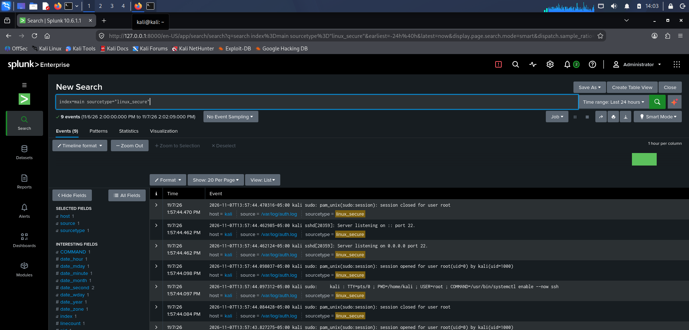
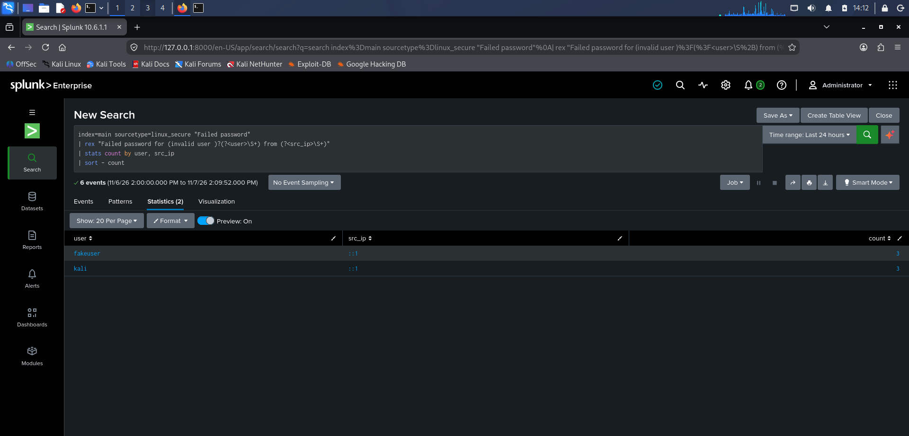
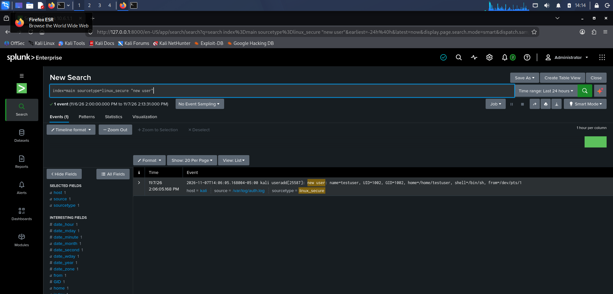
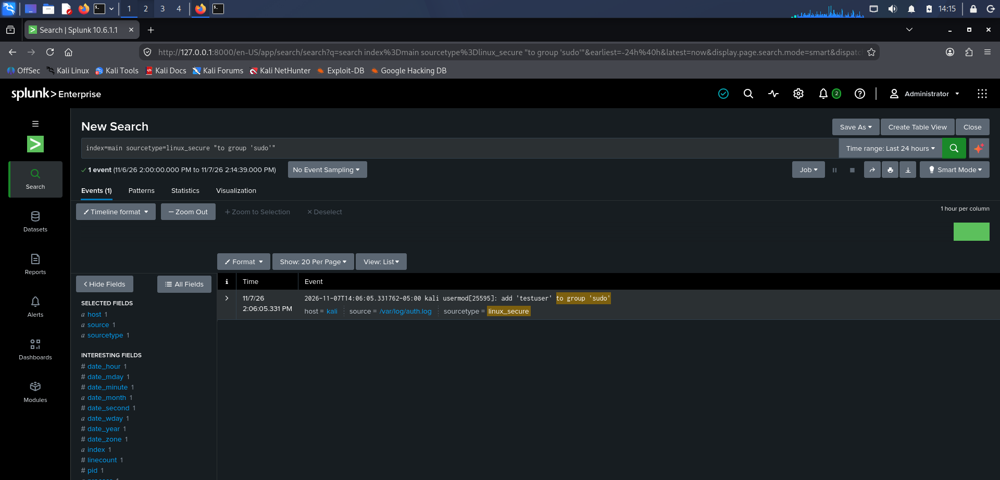
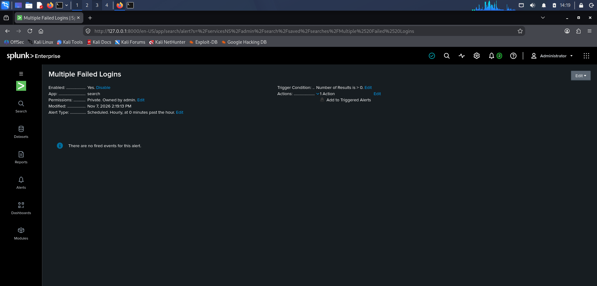
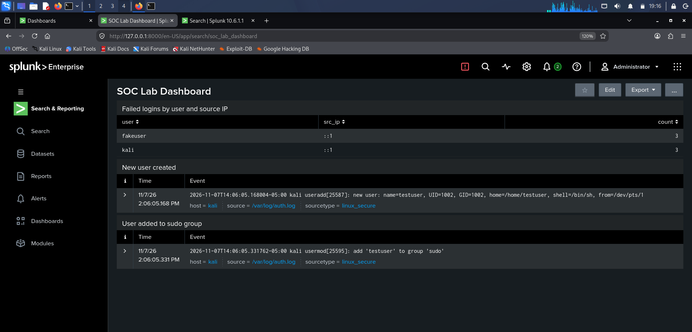

# Splunk SOC Home Lab

A small home lab where I use **Splunk Enterprise** to collect Linux authentication logs, detect suspicious activity, raise an alert and review it the way a Tier 1 SOC analyst would.

**What it detects**
- Failed SSH logins (password guessing), including attempts on accounts that do not exist
- A new local user account being created
- A user being added to the `sudo` (admin) group

## Lab setup

| Item | Detail |
|------|--------|
| Hypervisor | Oracle VirtualBox |
| Machine | Kali Linux VM (updated with `apt full-upgrade`), 4 GB RAM, 2 CPUs |
| SIEM | Splunk Enterprise 10.6.1.1 (free trial) installed on the same VM |
| Log source | `/var/log/auth.log` (via rsyslog and OpenSSH server) |
| Index / sourcetype | `main` / `linux_secure` |

Splunk monitors the log file directly. This is a single-VM lab, so Splunk is run as root with the `--run-as-root` flag. A production deployment would use a dedicated service account and a Universal Forwarder.

## Simulated activity

All activity below was created by me on my own VM, for training only:

1. Several failed SSH logins against a non-existent user (`fakeuser`) and against the real `kali` user.
2. Created a new account: `sudo useradd testuser`.
3. Added that account to the admin group: `sudo usermod -aG sudo testuser`.

## Detections

The full searches are in [`detections.md`](detections.md).

| # | Detection | Result |
|---|-----------|--------|
| 1 | Failed logins grouped by user and source IP | `fakeuser` (3) and `kali` (3), both from `::1` |
| 2 | New user created | `useradd: new user: name=testuser` |
| 3 | User added to sudo group | `usermod: add 'testuser' to group 'sudo'` |

Source IP `::1` is the IPv6 localhost address, because I tested against my own machine. In a real investigation I would check whether the source is an external address.

### Alert
**Multiple Failed Logins**: scheduled hourly, triggers when the number of results is greater than 0, action: Add to Triggered Alerts. The threshold is set low so the alert fires on lab data; a real SOC would tune it (for example 5+ failures from one source within 10 minutes).

### Dashboard
**SOC Lab Dashboard** shows failed logins by user and source IP, new accounts and sudo group changes.

## Screenshots

| | |
|---|---|
| Logs arriving in Splunk |  |
| Failed logins |  |
| New user created |  |
| User added to sudo |  |
| Alert configuration |  |
| Dashboard |  |

## Incident report

I wrote up the simulated activity as a Tier 1 ticket: [`incident-report.md`](incident-report.md).

## MITRE ATT&CK mapping

- **T1110.001** Brute Force: Password Guessing (failed SSH logins)
- **T1136.001** Create Account: Local Account (`useradd`)
- **T1098** Account Manipulation (adding a user to `sudo`)

## What I learned

- How to get Linux logs into Splunk and write SPL searches (`rex`, `stats`, `sort`) to pull out users and source IPs.
- How a failed login against a non-existent user differs from one against a real account.
- How to turn a search into a scheduled alert and a dashboard.
- Practical troubleshooting: Splunk refusing to start as root, and the seed file for the admin account only being read at start-up.

## Next steps

- Add a Windows VM and forward Windows Event Logs (4625, 4720, 4732) with the Universal Forwarder.
- Tune the alert threshold and add a time window.
- Add more detections (for example, sudo use by unexpected users).
